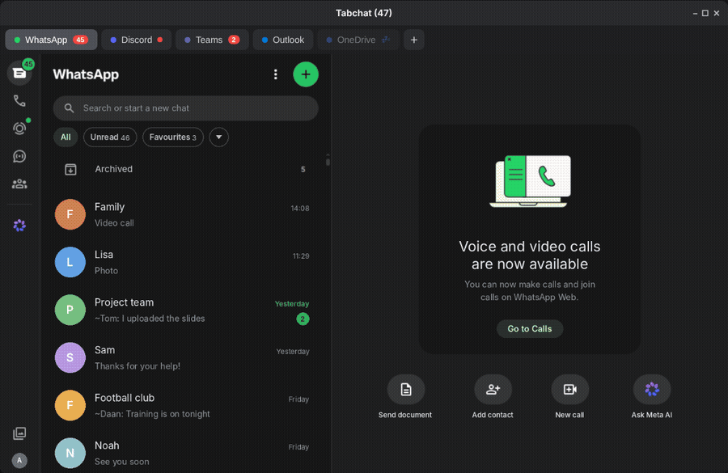

<p align="center">
  
</p>

<h1 align="center">Tabchat</h1>

<p align="center">
  <b>WhatsApp, Discord, Teams, Outlook and OneDrive in one window — made for Linux.</b><br>
  Light, keyboard-friendly and built to keep you signed in.
</p>

<p align="center">
  <a href="https://github.com/MMV2408/tabchat/releases/latest"></a>
  
  <a href="LICENSE"></a>
  <a href="https://github.com/sponsors/MMV2408"></a>
</p>

<p align="center">
  🇬🇧 English · <a href="README.nl.md">🇳🇱 Nederlands</a>
</p>

---

<p align="center">
  
</p>

## Why Tabchat?

Most chat apps on Linux are separate Electron apps, each running its own copy of Chromium. With WhatsApp, Discord and Teams open, that easily adds up to 3–4 GB of memory.

Tabchat puts them all in **one window with tabs**, sharing a single browser engine. On top of that it adds the things you miss in the web versions: a tray icon, unread counters, Do not disturb, keyboard shortcuts and a sleep mode for tabs you are not using.

## Features

**Tabs**
- 💬 WhatsApp, Discord, Teams, Outlook and OneDrive — add only what you need
- 👥 Multiple accounts of the same service, each with its own sign-in
- ↔️ Drag tabs to reorder them, right-click for more options
- 🔐 One shared Microsoft sign-in for Teams, Outlook and OneDrive (school and work accounts too), and it **stays signed in** after a restart


**Never miss a message**
- 🔴 Unread counters on every tab, a red dot on the tray icon and a number on the dock icon
- 🔔 Click a notification to jump straight to the right tab
- 🖥️ Keeps running in the background when you close the window, with a tray icon at the top right
- 🚀 Optionally starts hidden in the tray when you log in

**Peace and quiet**
- 🌙 Do not disturb for 1 hour, until tomorrow 08:00 or until you turn it off — blocks all notifications and sound. Also follows Ubuntu's own Do not disturb
- 💤 Tab sleep: tabs you have not used for a while are removed from memory and come back with one click. You choose per tab which ones may sleep

**Keyboard first**
- ⌨️ `Ctrl+K` quick search for every service and action
- `Alt+1…9`, `Ctrl+Tab`, `Ctrl+W`, `Ctrl+Shift+T` and more — just like a browser

**The rest**
- 🖼️ Screen sharing in Discord and Teams with a screen/window picker
- ⚠️ A clear error screen with automatic retry when you are offline
- 🔄 Automatic updates from GitHub Releases
- 🇬🇧 🇳🇱 English and Dutch
- ☀️ Light and dark theme that follows your system
- 🔗 Choose where links open: your default browser, another browser or Tabchat itself
- 🎨 Colored or white tray icon

<p align="center">
  
</p>

## Installation

Download the latest version from the **[Releases page](https://github.com/MMV2408/tabchat/releases/latest)**.

### Ubuntu, Debian, Linux Mint, Pop!_OS (`.deb`)

Double-click the downloaded file, or run:

```bash
sudo apt install ./tabchat_*_amd64.deb
```

Then open **Tabchat** from your app menu.

### Other distributions (`.AppImage`)

```bash
chmod +x Tabchat-*.AppImage
./Tabchat-*.AppImage
```

### Updates

Tabchat checks for new versions by itself and downloads them in the background. When an update is ready, a green button appears in the tab bar — click it and Tabchat restarts on the new version. You can turn this off on the **+** screen.

## Getting started

1. Open Tabchat and click **+** (or press `Alt+T`).
2. Add the services you use. Each one opens in its own tab.
3. Sign in once — Tabchat remembers it.

Everything else — language, tab sleep, start at login, white tray icon — is on the same **+** screen.

<p align="center">
  
</p>

## Keyboard shortcuts

| Shortcut | Action |
|---|---|
| `Ctrl+K` | Quick search: find a service or action |
| `Alt+T` | Open the + screen (services and settings) |
| `Alt+1` … `Alt+8` | Go to that tab |
| `Alt+9` | Go to the last tab |
| `Ctrl+Tab` / `Ctrl+Shift+Tab` | Next / previous tab |
| `Ctrl+W` | Close tab (your sign-in is kept) |
| `Ctrl+Shift+T` | Reopen closed tab |
| `Ctrl+Shift+PageUp` / `PageDown` | Move tab left / right |
| `F5` | Reload |
| `Alt+M` | Mute / unmute tab |
| `Alt+←` / `Alt+→` | Back / forward |
| `Ctrl` + `+` / `-` / `0` | Zoom in / out / reset (saved per tab) |
| `F11` | Full screen |
| `Ctrl+Q` | Really quit Tabchat |

On the + screen, `Alt` + the underlined letter adds a service (`W`hatsApp, `D`iscord, `T`eams, `O`utlook, O`n`eDrive).

## Privacy

- Tabchat **collects nothing**. No analytics, no tracking, no account.
- Your sign-ins stay on your own computer, in `~/.config/Tabchat`.
- Tabchat only talks to the services you add, and to GitHub to check for updates.
- To stay signed in to Microsoft, Tabchat keeps Microsoft's session cookies for 14 days. You are asked about this the first time, and you can turn it off on the + screen.

## FAQ

**Is this an official app?**
No. Tabchat is an independent open-source project and is not affiliated with WhatsApp, Meta, Discord or Microsoft. It shows the official web versions of these services.

**Why do I see Ubuntu's own picker when sharing my screen?**
On Wayland (the default on Ubuntu), apps are not allowed to look at your screen themselves; the system always asks. Tabchat detects this and skips its own picker. Sharing audio is not possible on Linux.

**A sleeping tab did not show my new messages.**
That is expected: a sleeping tab is fully unloaded. Turn off **May sleep** for that tab on the + screen to keep it awake. WhatsApp, Discord and Teams stay awake by default.

**Can I add other websites, like Gmail?**
Not yet. Some services, such as Gmail, block sign-in inside apps. Adding your own services is on the roadmap.

## Building from source

Requirements: [Node.js](https://nodejs.org) 20 or newer.

```bash
git clone https://github.com/MMV2408/tabchat.git
cd tabchat
npm install
npm start          # run in development
npm run dist       # build .deb and .AppImage into dist/
```

### Project structure

```
src/
  main/              The app itself (Electron main process)
    index.js         Entry point
    window.js        Builds the window
    store.js         Shared runtime state
    config.js        Saves and loads settings (~/.config/Tabchat/config.json)
    catalog.js       List of services and their addresses
    views.js         Creates, shows and hides tabs; error screen
    actions.js       Everything you can do: add, close, zoom, …
    shortcuts.js     All keyboard shortcuts
    palette.js       Quick search (Ctrl+K)
    microsoft.js     Microsoft sign-in (shared login, staying signed in)
    unread.js        Unread counters
    dnd.js           Do not disturb
    sleep.js         Tab sleep
    tray.js          Tray icon and running in the background
    autostart.js     Start at login
    share.js         Screen sharing picker
    updater.js       Automatic updates
    i18n.js          All texts in English and Dutch
    ipc.js           Messages from the screens to the app
  preload/
    preload.js       Bridge between Tabchat's own screens and the app
    service.js       Runs inside each service tab (unread badge, Do not disturb)
  renderer/          Tabchat's own screens (HTML)
assets/              Logo and tray icons
```

### Adding things

| What | Where |
|---|---|
| A service | One line in `CATALOG` in `src/main/catalog.js`, plus a description in `i18n.js` |
| A setting | `DEFAULT_SETTINGS` in `config.js`, `FEATURES` in `home.html`, texts in `i18n.js` |
| A shortcut | `shortcuts.js` and the list in `home.html` |
| A language | A new block in `i18n.js` and an option in `home.html` |

### Releasing a new version

1. Raise `version` in `package.json`.
2. `npm run dist`
3. Create a release with the `.deb`, `.AppImage` **and `latest-linux.yml`** (needed for automatic updates):

```bash
gh release create v1.2.3 dist/tabchat_1.2.3_amd64.deb dist/Tabchat-1.2.3.AppImage dist/latest-linux.yml \
  --title "Tabchat 1.2.3" --generate-notes
```

## Roadmap

- [ ] Add your own services (name + web address)
- [ ] Snap Store and Flathub
- [ ] Profiles (e.g. "School" and "Personal")

Ideas and bug reports are welcome in [Issues](https://github.com/MMV2408/tabchat/issues).

## Support Tabchat

Tabchat is free and stays free. If it saves you time, you can support development via **[GitHub Sponsors](https://github.com/sponsors/MMV2408)**. Starring the repo or reporting bugs helps too!

## License

[MIT](LICENSE) © Mike Vijverberg

WhatsApp, Discord, Microsoft Teams, Outlook and OneDrive are trademarks of their respective owners. Tabchat is not affiliated with or endorsed by them.
