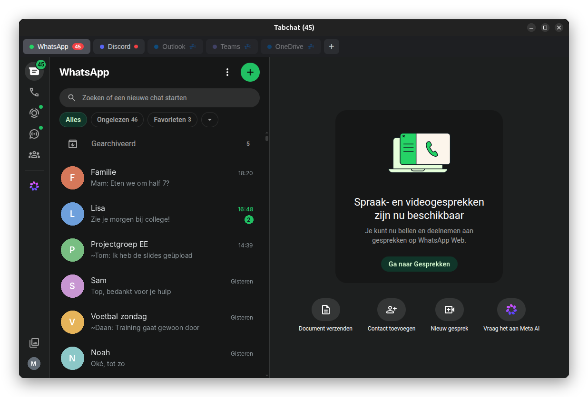
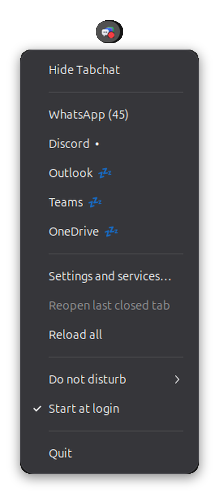
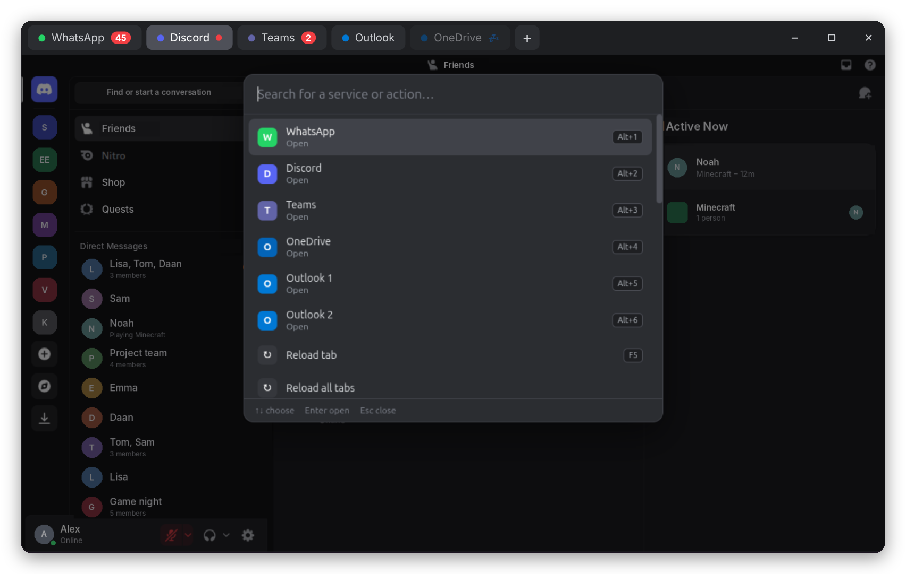
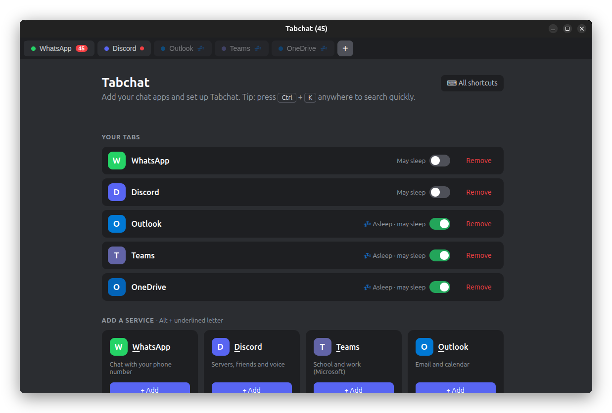

<p align="center">
  
</p>

<h1 align="center">Tabchat</h1>

<p align="center">
  <b>WhatsApp, Discord, Teams, Outlook en OneDrive in één venster — gemaakt voor Linux.</b><br>
  Licht, handig met het toetsenbord en gebouwd om je ingelogd te houden.
</p>

<p align="center">
  <a href="https://github.com/MMV2408/tabchat/releases/latest"></a>
  
  <a href="LICENSE"></a>
  <a href="https://github.com/sponsors/MMV2408"></a>
</p>

<p align="center">
  <a href="README.md">🇬🇧 English</a> · 🇳🇱 Nederlands
</p>

---

<p align="center">
  
</p>

## Waarom Tabchat?

De meeste chat-apps op Linux zijn losse Electron-apps, en elke app draait zijn eigen Chromium. Met WhatsApp, Discord en Teams open ben je zo 3 tot 4 GB geheugen kwijt.

Tabchat zet ze allemaal in **één venster met tabbladen**, met één gedeelde browser. Daarbovenop krijg je wat je mist in de webversies: een tray-icoon, ongelezen-tellers, Niet storen, sneltoetsen en een slaapstand voor tabbladen die je niet gebruikt.

## Functies

**Tabbladen**
- 💬 WhatsApp, Discord, Teams, Outlook en OneDrive — voeg alleen toe wat je gebruikt
- 👥 Meerdere accounts van dezelfde dienst, elk met een eigen login
- ↔️ Tabbladen verslepen, rechtsklik voor meer opties
- 🔐 Eén gedeelde Microsoft-login voor Teams, Outlook en OneDrive (ook voor school- en werkaccounts), en je **blijft ingelogd** na een herstart



**Nooit een bericht missen**
- 🔴 Ongelezen-tellers op elk tabblad, een rode stip op het tray-icoon en een getal op het dock-icoon
- 🔔 Klik op een melding en je zit meteen in het juiste tabblad
- 🖥️ Blijft op de achtergrond draaien als je het venster sluit, met een tray-icoon rechtsboven
- 🚀 Start desgewenst verborgen in de tray zodra je inlogt

**Rust**
- 🌙 Niet storen voor 1 uur, tot morgen 08:00 of tot je het uitzet — houdt alle meldingen en geluid tegen. Volgt ook Niet storen van Ubuntu zelf
- 💤 Slaapstand: tabbladen die je een tijd niet gebruikt, gaan uit het geheugen en komen met één klik terug. Per tabblad kies je wat mag slapen

**Toetsenbord eerst**
- ⌨️ `Ctrl+K` om elke dienst en actie snel te zoeken
- `Alt+1…9`, `Ctrl+Tab`, `Ctrl+W`, `Ctrl+Shift+T` en meer — net als in de browser

**En verder**
- 🖼️ Scherm delen in Discord en Teams, met een keuze voor scherm of venster
- ⚠️ Een duidelijk foutscherm dat vanzelf opnieuw probeert als je offline bent
- 🔄 Automatische updates via GitHub Releases
- 🇳🇱 🇬🇧 Nederlands en Engels
- ☀️ Licht en donker thema dat je systeem volgt
- 🔗 Kies waar links openen: je standaardbrowser, een andere browser of Tabchat zelf
- 🎨 Gekleurd of wit tray-icoon

<p align="center">
  
</p>

## Installeren

Download de nieuwste versie via de **[Releases-pagina](https://github.com/MMV2408/tabchat/releases/latest)**.

### Ubuntu, Debian, Linux Mint, Pop!_OS (`.deb`)

Dubbelklik op het gedownloade bestand, of gebruik:

```bash
sudo apt install ./tabchat_*_amd64.deb
```

Open daarna **Tabchat** via je app-menu.

### Andere Linux-versies (`.AppImage`)

```bash
chmod +x Tabchat-*.AppImage
./Tabchat-*.AppImage
```

### Updates

Tabchat zoekt zelf naar nieuwe versies en downloadt ze op de achtergrond. Staat er een update klaar, dan verschijnt er een groene knop in de tabbalk. Klik erop en Tabchat start opnieuw met de nieuwe versie. Je kunt dit uitzetten in het **+**-scherm.

## Aan de slag

1. Open Tabchat en klik op **+** (of druk op `Alt+T`).
2. Voeg de diensten toe die je gebruikt. Elke dienst opent in een eigen tabblad.
3. Log één keer in — Tabchat onthoudt het.

Al het andere — taal, slaapstand, starten bij inloggen, wit tray-icoon — staat in hetzelfde **+**-scherm.

<p align="center">
  
</p>

## Sneltoetsen

| Sneltoets | Wat het doet |
|---|---|
| `Ctrl+K` | Snelzoeken: dienst of actie zoeken |
| `Alt+T` | Het +-scherm openen (diensten en instellingen) |
| `Alt+1` … `Alt+8` | Naar dat tabblad |
| `Alt+9` | Naar het laatste tabblad |
| `Ctrl+Tab` / `Ctrl+Shift+Tab` | Volgend / vorig tabblad |
| `Ctrl+W` | Tabblad sluiten (je login blijft bewaard) |
| `Ctrl+Shift+T` | Gesloten tabblad terughalen |
| `Ctrl+Shift+PageUp` / `PageDown` | Tabblad naar links / rechts |
| `F5` | Herladen |
| `Alt+M` | Tabblad dempen / geluid aan |
| `Alt+←` / `Alt+→` | Terug / vooruit |
| `Ctrl` + `+` / `-` / `0` | Inzoomen / uitzoomen / herstellen (per tabblad onthouden) |
| `F11` | Volledig scherm |
| `Ctrl+Q` | Tabchat echt afsluiten |

In het +-scherm voegt `Alt` + de onderstreepte letter een dienst toe (`W`hatsApp, `D`iscord, `T`eams, `O`utlook, O`n`eDrive).

## Privacy

- Tabchat **verzamelt niets**. Geen statistieken, geen tracking, geen account.
- Je logins blijven op je eigen computer, in `~/.config/Tabchat`.
- Tabchat praat alleen met de diensten die jij toevoegt, en met GitHub om op updates te controleren.
- Om je ingelogd te houden bij Microsoft, bewaart Tabchat de sessie-cookies van Microsoft 14 dagen. Dat wordt je de eerste keer gevraagd, en je kunt het uitzetten in het +-scherm.

## Veelgestelde vragen

**Is dit een officiële app?**
Nee. Tabchat is een onafhankelijk open-sourceproject en niet verbonden met WhatsApp, Meta, Discord of Microsoft. Het toont de officiële webversies van deze diensten.

**Waarom zie ik het keuzevenster van Ubuntu bij scherm delen?**
Op Wayland (standaard op Ubuntu) mogen apps niet zelf naar je scherm kijken; het systeem vraagt het altijd. Tabchat herkent dat en slaat zijn eigen keuzevenster over. Geluid delen kan op Linux niet.

**Een slapend tabblad liet mijn nieuwe berichten niet zien.**
Dat klopt: een slapend tabblad is helemaal uitgeschakeld. Zet **Mag slapen** uit voor dat tabblad in het +-scherm om het wakker te houden. WhatsApp, Discord en Teams blijven standaard wakker.

**Kan ik andere sites toevoegen, zoals Gmail?**
Nog niet. Sommige diensten, zoals Gmail, blokkeren het inloggen in apps. Zelf diensten toevoegen staat op de planning.

## Zelf bouwen

Nodig: [Node.js](https://nodejs.org) 20 of nieuwer.

```bash
git clone https://github.com/MMV2408/tabchat.git
cd tabchat
npm install
npm start          # starten om te testen
npm run dist       # .deb en .AppImage bouwen in dist/
```

Meer over de mappenstructuur, iets toevoegen en een nieuwe versie uitbrengen staat in de [Engelse README](README.md#building-from-source).

## Planning

- [ ] Zelf diensten toevoegen (naam + webadres)
- [ ] Snap Store en Flathub
- [ ] Profielen (bijvoorbeeld "School" en "Privé")

Ideeën en bugmeldingen zijn welkom bij [Issues](https://github.com/MMV2408/tabchat/issues).

## Tabchat steunen

Tabchat is gratis en blijft gratis. Bespaart het je tijd, dan kun je de ontwikkeling steunen via **[GitHub Sponsors](https://github.com/sponsors/MMV2408)**. Een ster op de repo of een bugmelding helpt ook!

## Licentie

[MIT](LICENSE) © Mike Vijverberg

WhatsApp, Discord, Microsoft Teams, Outlook en OneDrive zijn merken van hun eigenaren. Tabchat is niet met hen verbonden en wordt niet door hen ondersteund.
